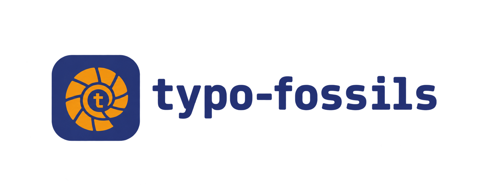
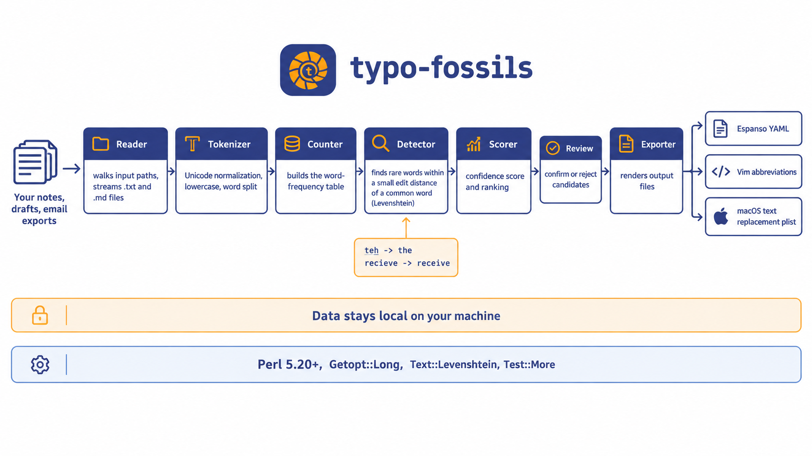

# typo-fossils



**Your mistakes, fossilized into a personal autocorrect dictionary.**

typo-fossils reads your own writing, finds the misspellings you repeat, and exports them as ready-to-use snippets for Espanso, Vim, and macOS text replacement. Generic autocorrect fixes everyone's typos. This fixes yours.


## Why typo-fossils

Most people misspell the same 20 to 30 words over and over. Built-in autocorrect is trained on everyone, so it misses the patterns that are specific to you. The evidence is already sitting in your notes, drafts, and exported emails. typo-fossils digs it out.

- **Personal by design.** The dictionary is built from your text, not a generic word list.
- **Frequency-aware.** Words you use often are treated as correct. Rare near-duplicates of them are the suspects.
- **Ranked, not guessed.** Every candidate gets a confidence score so you review the strongest ones first.
- **Slips versus gaps.** A keyboard model tells a fumbled key from a spelling you do not know, so you can focus on the mistakes that repeat.
- **You stay in control.** Nothing is exported until you accept it in the review step.
- **Measurable progress.** Snapshots of your typo rate show whether the mistakes are fading, and which ones you have retired.
- **Export anywhere.** One run produces snippets for the tools you already use.
- **Local and private.** Your text never leaves your machine.

## How it works

1. **Ingest.** Read plain text and Markdown files from a path you provide.
2. **Tokenize.** Normalize Unicode, lowercase, and split into words.
3. **Count.** Build a word-frequency table across the whole corpus.
4. **Detect.** Flag rare words within a small edit distance of a common word, such as `teh` against `the`, and score each one.
5. **Classify.** Use the keyboard layout to label each candidate as a slip, a gap, or unclear.
6. **Review.** Accept, reject, or edit each candidate. Decisions are saved as you go.
7. **Export.** Write the accepted pairs in the format your tool expects.
8. **Track.** Record how often you still make the accepted typos, and watch the rate fall.

## Quick start

```
cpanm --installdeps .
prove -l t
perl bin/typo-fossils --version
```

## Usage

### Count words

Build a word-frequency table from any file or folder of `.txt` and `.md` files.

```
typo-fossils freq ~/notes --top 20 --min-count 2
```

Hidden folders are skipped, and URLs and email addresses are ignored. Output is one `count  word` pair per line, most frequent first.

### Find likely typos

Find rare words that sit one or two edits away from a word you use often.

```
typo-fossils scan ~/notes
```

```
CONF    TYPO              FIX                SEEN   COMMON  KIND
0.800   definately        definitely            1        8  gap (vowel swap)
0.778   occured           occurred              1        8  gap (missing double letter)
0.762   recieve           receive               1        8  gap (ie/ei swap)
0.593   teh               the                   1        8  slip (swapped letters)
```

The table is ranked by confidence and shows the suspected typo, the suggested fix, how often each appears, and the kind of mistake. Adjacent swaps such as `teh` and `the` count as a single edit.

| Option | Meaning | Default |
| --- | --- | --- |
| `--top N` | Show at most N candidates | 50 |
| `--max-distance N` | Largest edit distance to a correction | 2 |
| `--min-common N` | Times a correction must appear | 5 |
| `--max-typo N` | Most times a typo may appear | 3 |
| `--min-ratio N` | How many times more common the correction must be | 5 |
| `--kind KIND` | `slip`, `gap`, `unclear`, or `all` | `all` |
| `--layout NAME` | `qwerty`, `azerty`, or `qwertz` | `qwerty` |

Words of four letters or fewer allow one edit. Longer words allow up to `--max-distance`.

### Slips and gaps

Each candidate is labelled with the kind of mistake it looks like, based on where the keys sit on your keyboard.

| Kind | What it means | Examples |
| --- | --- | --- |
| slip | Your fingers misfired | `teh` (swapped), `thw` (neighbouring key), `wrd` (dropped letter) |
| gap | You probably do not know the spelling | `recieve`, `seperate`, `occured` |
| unclear | Does not fit either pattern | anything with several edits |

Gaps repeat, so they pay off most as autocorrect entries. Review only those with:

```
typo-fossils review ~/notes --kind gap
```

The label is a best guess. Some habitual misspellings, such as `becuase`, look like plain swaps and are called slips. The label only affects display and the `--kind` filter. It does not change confidence or what gets exported.

### Review candidates

Go through the candidates one by one. Every answer is saved immediately, so you can quit and resume at any time.

```
typo-fossils review ~/notes
```

```
[1/3] recieve -> receive   seen 2, common 18, confidence 0.771, gap (ie/ei swap)
[a]ccept  [r]eject  [e]dit  [s]kip  [q]uit >
```

Press `a` to accept, `r` to reject, `e` to type your own correction, `s` to skip, or `q` to quit. Accepted and rejected decisions are stored in `~/.config/typo-fossils/decisions.json`, or in the folder named by `XDG_CONFIG_HOME`. Use `--store FILE` to keep them elsewhere. An accepted typo is never offered again. A rejected pair comes back only if it later gets a different suggested fix.

Show everything you have accepted so far:

```
typo-fossils list
```

### Export

Turn your accepted typos into snippets for the tool you use.

```
typo-fossils export --format espanso --out typos.yml
typo-fossils export --format vim --out typos.vim
typo-fossils export --format macos --out typos.plist
```

`--format` can be left out when `--out` ends in `.yml`, `.vim`, or `.plist`. Without `--out`, the result is printed so you can pipe it. Entries a format cannot hold, such as a trigger with an apostrophe in Vim, are skipped with a warning. With nothing accepted yet, the command exits with status 1 and writes no file.

**Espanso.** Run `espanso path` to find your config folder and copy `typos.yml` into its `match` folder. Each entry matches whole words only and keeps your capitalization, so `Teh` becomes `The`.

**Vim.** Add `source ~/typos.vim` to your vimrc. The entries are insert-mode abbreviations.

**macOS.** Drag `typos.plist` into the Text Replacements list in System Settings, under Keyboard.

### Track your progress

Once you have accepted some typos, record how often you still make them. Each run saves a snapshot of your typo rate per 1,000 words, so you can see whether you are improving.

```
typo-fossils track ~/notes --since 2026-10-15
```

```
Recorded 2026-10-22: 851 words, 1 typo (1.2 per 1,000 words).
```

| Option | Meaning | Default |
| --- | --- | --- |
| `--since DATE` | Only read files modified on or after this date (`YYYY-MM-DD`) | all files |
| `--date DATE` | The date to record the snapshot under | today |
| `--store FILE` | Where your accepted typos are kept | the default decisions file |
| `--history FILE` | Where snapshots are kept | `~/.config/typo-fossils/history.json` |

Only accepted typos are counted, so run `review` first. Use `--since` to measure your new writing rather than your whole archive, otherwise old typos in old notes keep counting. A file you edit is read in full, so typos in older parts of it can be counted again. Tracking the same date twice updates that day's snapshot instead of adding a second one. The history file lives in the folder named by `XDG_CONFIG_HOME` when it is set.

### See your stats

```
typo-fossils stats
```

```
Snapshots: 4 (2026-10-01 to 2026-10-22)
Words tracked: 3,170
Typos found: 25

Typo rate per 1,000 words
DATE          WORDS  TYPOS    RATE  CHANGE
2026-10-01      692     12    17.3       -
2026-10-08      773      8    10.3    -40%
2026-10-15      854      4     4.7    -55%
2026-10-22      851      1     1.2    -75%

Down 93% since 2026-10-01 (17.3 to 1.2 per 1,000 words).

Hall of fame
#     TYPO              FIX               TOTAL  SNAPSHOTS  LAST SEEN
1     teh               the                  10          4  2026-10-22
2     recieve           receive               6          3  2026-10-15
3     seperate          separate              4          3  2026-10-15

Retired (not in your latest snapshot): recieve (6), seperate (4)
```

The trend compares each snapshot with the one before it. The hall of fame ranks your most repeated typos across all snapshots. Retired typos showed up in earlier snapshots but not in the latest one. Use `--top N` to change how many entries are listed, 10 by default. Rates from a few hundred words are noisy, so judge progress by the trend over several snapshots.

## Export formats

**Espanso**

```yaml
matches:
  - trigger: "teh"
    replace: "the"
    word: true
    propagate_case: true
  - trigger: "recieve"
    replace: "receive"
    word: true
    propagate_case: true
```

**Vim**

```vim
iabbrev teh the
iabbrev recieve receive
```

**macOS text replacement**

A property list of phrase and shortcut pairs that can be imported into System Settings.

```xml
<array>
	<dict>
		<key>phrase</key>
		<string>the</string>
		<key>shortcut</key>
		<string>teh</string>
	</dict>
</array>
```

## Architecture



The pipeline is a sequence of small, independently testable stages. Each stage takes plain Perl data structures in and returns them out, so stages can be tested in isolation and swapped without touching the rest.

| Stage | Responsibility |
| --- | --- |
| Reader | Walks input paths and streams file contents |
| Tokenizer | Unicode normalization and word splitting |
| Counter | Builds the frequency table |
| Detector | Finds near-miss pairs using edit distance and scores them |
| Keyboard | Key layouts, adjacency, and slip or gap labels |
| Review | Interactive accept, reject, and edit loop |
| Store | Saves decisions as JSON between runs |
| Exporter | Renders Espanso, Vim, and macOS output |
| History | Saves one snapshot of your typo counts per tracked run |
| Stats | Computes the trend, hall of fame, and retired typos |

## Tech stack


| Concern | Choice |
| --- | --- |
| Language | Perl 5.20+ |
| CLI parsing | Getopt::Long |
| Similarity | Text::Levenshtein, plus adjacent-swap handling |
| Keyboard model | Built-in QWERTY, AZERTY, and QWERTZ key geometry |
| Unicode | Unicode::Normalize |
| Storage | JSON::PP for decisions and history |
| Dates | POSIX and Time::Local |
| Testing | Test::More with prove |
| Dependencies | cpanm with cpanfile |

## Project structure

```
bin/typo-fossils                command-line entry point
lib/Typo/Fossils.pm             core module and version
lib/Typo/Fossils/Reader.pm      file discovery and UTF-8 reading
lib/Typo/Fossils/Tokenizer.pm   normalization and word splitting
lib/Typo/Fossils/Counter.pm     frequency table and ranking
lib/Typo/Fossils/Detector.pm    edit distance and typo scoring
lib/Typo/Fossils/Keyboard.pm    key layouts, adjacency, and slip or gap labels
lib/Typo/Fossils/Review.pm      interactive accept, reject, edit loop
lib/Typo/Fossils/Store.pm       saved decisions file
lib/Typo/Fossils/Exporter.pm    Espanso, Vim, and macOS renderers
lib/Typo/Fossils/History.pm     snapshot storage and date handling
lib/Typo/Fossils/Stats.pm       trend, hall of fame, and report
t/                              test suite
assets/                         logo and architecture diagram
cpanfile                        dependency manifest
```

## Roadmap

- [x] Project skeleton, version flag, and test harness
- [x] Tokenizer with Unicode normalization
- [x] Word-frequency table
- [x] Edit-distance typo detection
- [x] Confidence scoring and ranking
- [x] Interactive review
- [x] Espanso, Vim, and macOS exporters
- [x] Keyboard-adjacency model to separate slips from spelling gaps
- [x] Typo history and improvement tracking
- [x] Typo hall of fame report

## Contributing

Issues and pull requests are welcome. Run `prove -l t` before submitting and keep each change focused on one stage of the pipeline.